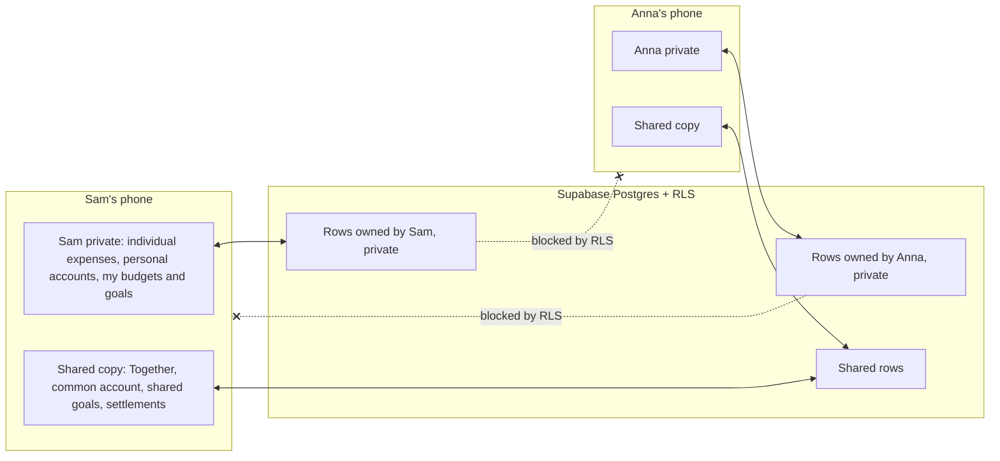
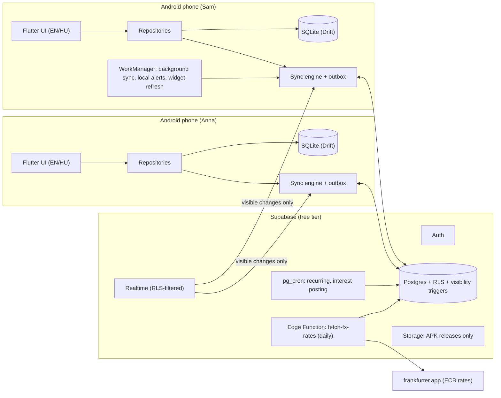
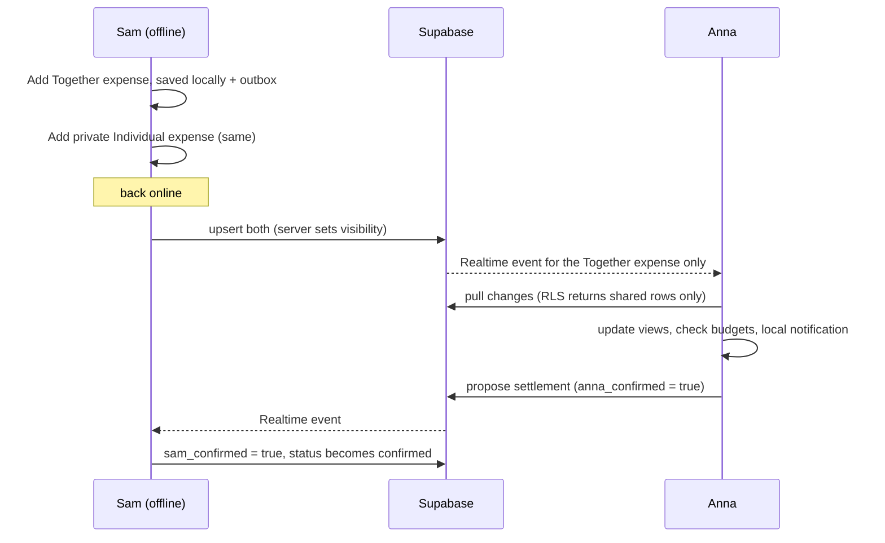
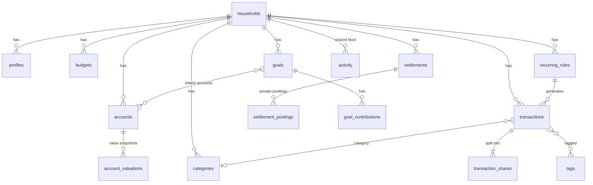
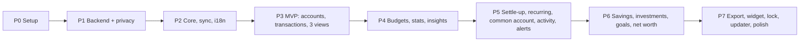

# Duo Wallet — Implementation Plan (v3)

A private Android app for two people. It tracks expenses, income, accounts (including a common bank account), savings, investments and goals, with budgets, statistics, insights and reminders. It is **offline-first** and syncs through a free Supabase backend. You install it by sideloading the APK, in **English and Hungarian**.

Project folder: `d:\Stuff\AI Projects\duo_wallet\`

> You wrote "Duo Wallett" with two t's. I'm assuming that was a typo and using **Duo Wallet**. The name is a single string, so it's trivial to change.

### What changed since v2
- **Strict privacy:** each partner's *individual* expenses, income, personal accounts, personal budgets, personal goals and net worth are **private**. Your partner can't see them in the app and **they never reach your partner's phone**. Only *Together* items and the *common account* are shared. See [Privacy model](#privacy-model).
- The "Me / Partner" switch on the Individual view is removed.
- "Together" is now defined by an explicit **scope** flag instead of by counting shares.
- Common-account expenses are always Together.
- Settle-up payments can optionally adjust **your own** account balance, privately.
- The emergency fund works separately for personal and shared funds.
- Everything else from v2 is unchanged.

---

## User Review Required

> [!IMPORTANT]
> **Privacy is enforced in the database, not just hidden in the UI.** Postgres Row Level Security (RLS) stops the server from returning your partner's private rows at all. Realtime updates follow the same rules. Your partner's phone never downloads your private data, so there is nothing to find by poking around in the app or its local database.

> [!WARNING]
> **Limits of that privacy.** Whoever **owns the Supabase project** can technically read every row through the Supabase dashboard (they own the database). That's fine if the two of you trust each other with that access, but it isn't end-to-end encryption. Encrypting private fields so that even the project owner can't read them is possible but adds real complexity (key management, no server-side totals). I left it out of v1. Tell me if you want it.

> [!IMPORTANT]
> **Rules that follow from your decisions:**
> 1. A shared expense paid from the **common account** creates **no** debt between you.
> 2. Extra money put into the common account **doesn't** count toward settle-up. It only shows as "ahead / behind" in the contribution tracker.
> 3. Expenses paid from the common account are always **Together**, because the common account's statement is visible to both of you.
> 4. A *Together* expense paid from a **personal** account shows your partner "Sam paid" and the amount and split. It does **not** reveal which personal account or its balance. They see "Sam's personal account".
> 5. A **contribution** (personal → common) shows both of you the amount and who sent it, but not the source account.

> [!WARNING]
> **Sideloading:** every APK must be signed with the **same keystore**, created once and backed up. Otherwise Android refuses updates. Each phone also needs "Install unknown apps" allowed for the installer, and later for the app itself (for the in-app updater).
> **Supabase free tier:** a project pauses after 7 idle days. A free GitHub Actions job pings it every 3 days.

---

## Decisions locked in

| Topic | Decision |
|-------|----------|
| Stack | Flutter (Android APK) + Supabase, sideloaded, no Play Store |
| Name | Duo Wallet |
| Languages | English and Hungarian |
| Currencies | **HUF** (base, default), **RON**, **EUR**. Automatic daily ECB rates, usable offline from cache |
| Views | **Together**, **Individual** (private), **My Total** (my individual + my share of Together) |
| Default split | 50/50, editable on every Together expense |
| Privacy | Individual items and personal accounts are private. Together and common items are shared |
| Offline | Full offline use, with sync later |
| Notifications | Local only, after sync. No push service |
| Income, savings, investments, goals, emergency fund | All included |
| Accounts | Cash (personal each, plus optional shared), bank (common or personal), savings, investment, deposit |
| Common account | Contribution transfers and a monthly cash-flow view. Extra contributions don't affect settle-up |
| Settle-up | Both persons must confirm. Common-account spending creates no debt |
| Extras kept | Shared goals, home widget, activity feed, insights, recurring and subscriptions, settle-up, export |
| Dropped | Receipt photos and OCR, bank import, expense comments, push notifications |
| Interest tax | Optional "tax on interest %" per account, default 0% |

---

## Privacy model

Every record is either **Private** (only its owner can read or write it) or **Shared** (both partners can). The server decides this with a trigger. The app can't set it wrongly.

| Data | Visibility |
|------|-----------|
| **Individual expense** | 🔒 Private to its owner |
| **Together expense** (any account, any split) | 👥 Shared |
| Expense paid from the **common account** | 👥 Shared (always Together) |
| **Income** into a personal account | 🔒 Private |
| Income into the common account | 👥 Shared |
| Transfer between two **personal** accounts | 🔒 Private |
| **Contribution** personal → common, and any transfer involving the common account | 👥 Shared (amount and who, not the source account) |
| **Personal account** (cash, bank, savings, investment, deposit) and its valuations | 🔒 Private |
| **Common account** (and shared cash) | 👥 Shared |
| Budget "Together" (total or per category) | 👥 Shared, editable by both |
| Budget "My" (applies to My Total) | 🔒 Private |
| Goal marked **Shared** (including shared emergency fund) | 👥 Shared |
| Goal marked **Personal** | 🔒 Private |
| Net worth | **Mine** 🔒 and **Common** 👥. There is no combined household figure, since it would reveal your partner's private balances |
| Recurring rule | Follows what it generates (Together or common = shared, otherwise private) |
| Settlement (proposal, confirmation, history) | 👥 Shared |
| Settlement postings to your own account (see settle-up) | 🔒 Private |
| Activity feed | 👥 Only shared events appear, for example "Anna added Groceries 8 450 Ft (Together)". Private actions never create feed entries |
| Categories and tag **names**, profiles (name, color, language) | 👥 Shared labels. *Which* transactions use a category or tag stays private for private ones |
| Statistics, insights, export, widget | Only built from data **you** can see: Together plus My Total. Never your partner's private data |

### Design rules that make this safe
1. **Visibility is set by a server trigger** from the transaction's content, and **can't change afterwards**. To turn an Individual expense into a Together one, or the reverse, the app **creates a new row and soft-deletes the old one**. Your partner then only ever sees "this shared expense was deleted". Private data never becomes visible because of an edit.
2. **No foreign keys leak data.** A shared expense paid from a personal account stores `paid_by` and `paid_from_common=false`. The `account_id` points to a row your partner can't read, so their app shows "Sam's personal account". The local database has **no foreign key** on `account_id`.
3. **Views and RPCs run as `security invoker`**, so RLS applies to every aggregate.
4. **Realtime** uses the default replica identity, so DELETE events carry only a primary key. Updates and inserts are filtered by RLS per subscriber.
5. **Server jobs** (recurring, interest) run with a service role, but write rows that the same triggers then classify.
6. **Local database on each phone contains only what that user may see.** That also makes the JSON backup safe to share by mistake.



---

## Feature Set

### Expenses & views

| # | Feature | Details |
|---|---------|---------|
| F1 | **Accounts & household** | Two users join one household by invite code. Sign-ups close once both have joined. |
| F2 | **Transactions** | Three kinds: **Expense**, **Income**, **Transfer**. Fields: amount, currency, date, category, note, merchant, **account paid from**, tags. |
| F3 | **Scope and split** | Every expense is **Individual** (mine alone, private) or **Together** (shared). Together defaults to **50/50** and is editable per expense with a slider or exact amounts. Any split from 0% to 100% is allowed, so "I paid Anna's dentist" is a Together expense with a 0/100 split. |
| F4 | **View: Together** | All Together expenses at **full amount**, whoever paid and whichever account. Both of you see the same list. |
| F5 | **View: Individual** | Only **my** individual expenses (private). |
| F6 | **View: My Total** | My individual expenses **plus my share (%) of each Together expense**. This is your real personal cost of living. |
| F7 | **Dashboard (overview)** | Everything you can see in one place: month spend (My Total and Together), budgets, my accounts and the common account, balance owed, goals, insights, shared activity. |
| F8 | **Categories** | Default set in EN/HU, editable, with icons, colors and optional subcategories. Separate expense and income categories. An "Essential" flag is used by the emergency fund. |
| F9 | **History** | Year → month navigation, month and year summaries, search, filters (category, account, tag, view, amount range). |
| F10 | **Quick add** | Amount keypad first, then category chips. Remembers last category, account and split per merchant. Templates for frequent items. |
| F11 | **Tags** | For example "Greece 2027", to see an event's cost across categories. |

### Money & accounts

| # | Feature | Details |
|---|---------|---------|
| M1 | **Multi-currency** | Base **HUF**, plus **RON** and **EUR**. Daily ECB rates (frankfurter.app) are fetched by the server and cached on the phone, so they work offline. The rate is locked when you enter the transaction and can be edited to match the bank's rate. Reports are in HUF by default, with an option to view them in EUR or RON. |
| M2 | **Accounts** | Types: Cash, Bank, Savings, Investment, Deposit. Each is **Common** 👥 or **Personal** 🔒 (with an owner). Each has its own currency (a EUR account, for example), opening balance, and live balance. Each person gets a personal Cash account, plus an optional shared Cash account. |
| M3 | **Transfers** | Don't count as spending or income. Work across currencies (HUF → EUR). A transfer from a personal account to the common account is a **contribution**. |
| M4 | **Common-account cash flow** | Per month: contributions per person, expenses, income, opening/closing balance. Each person can set an agreed monthly contribution. The app shows who is ahead or behind and reminds you, but it **doesn't affect settle-up**. |
| M5 | **Income** | Salary, bonus, freelance, interest, gifts. Personal income is private. Shows savings rate and "money left this month" from my private data. |
| M6 | **Settle-up (confirmed)** | A running "Sam owes Anna 12 400 Ft". Either of you proposes a settlement ("I paid you 12 400 Ft"). **The other must confirm it** before it counts. Pending, confirmed and rejected settlements stay in a history. When you confirm or propose, you can optionally pick **your own account** to adjust (money out for the payer, money in for the receiver). That adjustment is private and not visible to your partner. |

### Savings, investments & goals

| # | Feature | Details |
|---|---------|---------|
| S1 | **Savings / deposit accounts with interest** | Annual rate, compounding (daily, monthly, quarterly, yearly), start and maturity date, and tax %. Projects the value at maturity or any date. Optional automatic interest posting. |
| S2 | **Investment accounts** | Contributions are transfers in. Value is updated by manual valuation snapshots, giving gain/loss and return %. Includes an expected-return projection. |
| S3 | **Interest calculator** | A standalone tool: starting amount, monthly contribution, rate, compounding, years, tax. Shows final value, total interest, and a contributions-vs-interest chart. You can create a goal from a scenario. |
| S4 | **Goals (shared or personal)** | Car, vacation, a new phone… Target amount, currency, deadline, and linked account(s) or manual contributions. Shows contributions per person (for shared goals), the **required monthly saving** to hit the deadline, and a projected finish date including interest. Personal goals are private. |
| S5 | **Emergency fund** | A special goal with a target of **N months** (default 6) of essential expenses, recalculated automatically. A **personal** fund uses my *My Total* essential expenses (private). A **shared** fund uses *Together* essential expenses by default, with an optional manual override target. It shows how many months are covered. |
| S6 | **Net worth** | **Mine** (private) and **Common**, each with a monthly trend chart. |

### Planning, insights & UX

| # | Feature | Details |
|---|---------|---------|
| P1 | **Budgets** | A monthly total and per-category budgets. **Together budgets** (shared, editable by both) apply to Together expenses. **My budgets** (private) apply to My Total. Optional rollover. Alerts at 50/80/100%. |
| P2 | **Statistics** | Category donut, monthly trend, daily cumulative spend vs budget, month vs previous month, year vs previous year, top merchants, weekday pattern, Together vs Individual ratio, income vs expenses, savings rate. Each one runs on the Together view or My Total. |
| P3 | **Insights** | Generated on the phone from data you can see, for example "Dining is 35% above your 3-month average", "On track to finish 18 000 Ft under budget", "Subscriptions cost 24 990 Ft/month", "Car goal: save 60 000 Ft/month to make the deadline". |
| P4 | **Recurring & subscriptions** | Rules for expenses, income and transfers (rent, Netflix, salary, monthly contribution to the common account). Each rule either auto-creates the transaction or asks for confirmation. A subscription overview shows monthly and yearly fixed costs and upcoming bills. |
| P5 | **Activity feed** | Shared events only: "Anna added Groceries 8 450 Ft", "Sam proposed a settlement", "Car goal reached 50%". |
| P6 | **Local reminders** | Budget thresholds, upcoming bills, optional daily "log your expenses", monthly summary on the 1st, common-account contribution due, **settlement waiting for your confirmation**, goal milestones. They fire after foreground or background sync. |
| P7 | **Home-screen widget** | Remaining monthly budget, My Total this month, and a quick-add button. An option hides amounts, since the widget is visible on the home screen. |
| P8 | **Export & backup** | XLSX and CSV for a chosen period and view, with sheets for Transactions, By category, By month, Accounts and Goals. Shared through the Android share sheet. Full JSON backup and restore. Exports contain only data you can see. |
| P9 | **App lock & theming** | Fingerprint or PIN lock, hide amounts, dark mode, Material You colors. |
| P10 | **In-app updater** | Checks `latest.json` in Supabase Storage, then downloads and installs the newer APK. |
| P11 | **Languages** | English and Hungarian. Follows the phone's language, with a manual switch. Local formatting, for example `12 345 Ft` / `2026. 10. 03.` in Hungarian. |

---

## How the three views are calculated

Every expense has one **share row per person**, with a `scope` of `individual` or `together`. For example, a 10 000 Ft Together expense split 60/40 has the rows Sam = 6 000 and Anna = 4 000.

| View | Rows included | Amount shown |
|------|---------------|--------------|
| **Together** | `scope = together` | Full amount |
| **Individual** 🔒 | `scope = individual` and mine | Full amount (= my share) |
| **My Total** | My individual expenses **plus** every Together expense where my share > 0 | **My share only** |

```dart
enum ExpenseView { together, individual, myTotal }

int amountFor(Txn t, ExpenseView v, String me) => switch (v) {
  ExpenseView.together   => t.scope == Scope.together ? t.baseAmount : 0,
  ExpenseView.individual => t.scope == Scope.individual ? t.baseAmount : 0, // only mine exist locally
  ExpenseView.myTotal    => t.baseShares[me] ?? 0,
};
```

### Settle-up balance

```text
For each Together expense paid from a PERSONAL account or PERSONAL cash:
    payer is owed = the other person's share
Paid from the COMMON account (or shared cash)  -> no debt
Contributions to the common account            -> no debt
Balance(Sam->Anna) = Σ(Anna's shares on Sam-paid) - Σ(Sam's shares on Anna-paid)
                     ± CONFIRMED settlements   (pending ones are shown separately)
```

All balances are calculated in HUF using each transaction's locked rate. Both partners can compute the balance from shared data alone, since `paid_by`, `paid_from_common` and the shares are all on shared rows.

---

## Architecture



### Offline-first sync

- Every record gets a **UUID generated on the phone**. Writes go to SQLite and an **outbox**, so the UI updates instantly with no internet.
- The sync engine **pushes** the outbox as idempotent upserts, then **pulls** rows where `updated_at > last_pulled_at`. RLS means the pull returns only what you may see. Realtime triggers an immediate pull, and WorkManager syncs periodically in the background.
- **Last-write-wins** per row (the server sets `updated_at`). Deletes are soft (`deleted_at`). Either partner can edit shared rows. Only the owner can edit private rows.
- **Scope changes** (Individual ↔ Together) are done as "create new row + soft-delete old row", never as an in-place edit. See [Design rules](#design-rules-that-make-this-safe).
- **Settlement confirmations can't conflict.** Each person has their own confirmation column. A trigger lets *you* set *your* flag and never clears the other's.
- **Recurring transactions can't duplicate.** Generated transactions get a **deterministic UUID** (UUIDv5 of `rule_id + due_date`). The server job and an offline phone can both create one and it merges into a single row.
- **FX rates:** the phone keeps the latest rates locally. Offline entries use the cached rate and are marked `fx_source = 'cached'`.



### Tech stack

| Layer | Choice |
|-------|--------|
| App | Flutter 3.x stable, Dart 3, Material 3 |
| State / DI | `flutter_riverpod` |
| Navigation | `go_router` |
| Local DB | `drift` (SQLite) |
| Backend SDK | `supabase_flutter` |
| Localization | `flutter_localizations`, `intl`, ARB files (`app_en.arb`, `app_hu.arb`) via `gen-l10n` |
| Charts | `fl_chart` |
| Export | `excel`, `csv`, `share_plus`, `path_provider`, `file_picker` (restore) |
| Background / alerts | `workmanager`, `flutter_local_notifications` |
| Widget | `home_widget` (Kotlin `AppWidgetProvider` + layout XML) |
| Security | `local_auth`, `flutter_secure_storage` |
| Misc | `uuid` (v4 and v5), `connectivity_plus`, `package_info_plus`, `ota_update` |
| Backend | Supabase Postgres 15, RLS, Realtime, `pg_cron`, Edge Functions (TypeScript), Storage |
| CI | GitHub Actions: analyze, test, signed APK, upload release, keep-alive |

---

## Data Model (Postgres)

Money is stored as `bigint` **minor units**. HUF, RON and EUR all have 2 decimals by ISO standard. HUF is displayed without decimals.



### Key tables (abridged)

```sql
create table households (
  id uuid primary key default gen_random_uuid(),
  name text not null,
  base_currency char(3) not null default 'HUF',
  default_split_pct smallint not null default 50,
  invite_code text unique,
  emergency_fund_months smallint not null default 6,
  created_at timestamptz default now()
);

create table profiles (
  id uuid primary key references auth.users on delete cascade,
  household_id uuid references households,
  display_name text not null, color text not null,
  locale text default 'hu',
  monthly_common_contribution_minor bigint,      -- agreed amount (optional, shared)
  updated_at timestamptz default now()
);

create table accounts (
  id uuid primary key,
  household_id uuid not null references households,
  name text not null,
  type text not null check (type in ('cash','bank','savings','investment','deposit')),
  ownership text not null check (ownership in ('common','personal')),   -- = visibility
  owner_id uuid references profiles,              -- required when personal
  currency char(3) not null check (currency in ('HUF','RON','EUR')),
  opening_balance_minor bigint not null default 0,
  opening_date date not null,
  interest_rate_pct numeric(6,3),
  compounding text check (compounding in ('daily','monthly','quarterly','yearly')),
  interest_tax_pct numeric(5,2) default 0,
  maturity_date date,
  auto_post_interest boolean default false,
  include_in_net_worth boolean default true,
  icon text, color text, archived boolean default false,
  updated_at timestamptz default now(), deleted_at timestamptz,
  check (ownership = 'common' or owner_id is not null)
);

create table transactions (
  id uuid primary key,
  household_id uuid not null references households,
  kind text not null check (kind in ('expense','income','transfer')),
  scope text not null check (scope in ('individual','together')),   -- expenses; others derived
  visibility text not null check (visibility in ('private','shared')),  -- set by trigger, immutable
  occurred_on date not null,
  amount_minor bigint not null check (amount_minor > 0),
  currency char(3) not null,
  fx_rate_to_base numeric(18,8) not null,
  fx_source text default 'ecb',                   -- ecb | cached | manual
  base_amount_minor bigint not null,
  paid_by uuid not null references profiles,      -- who paid / owns it
  paid_from_common boolean not null,              -- visible to both; drives settle-up
  account_id uuid not null,                       -- NO FK to readable rows; may be hidden
  account_amount_minor bigint not null,
  to_account_id uuid,                             -- transfers
  to_account_amount_minor bigint,
  is_contribution boolean default false,          -- personal -> common transfer
  category_id uuid references categories,
  merchant text, note text,
  recurring_rule_id uuid,
  created_by uuid not null references profiles,
  created_at timestamptz default now(),
  updated_at timestamptz default now(), deleted_at timestamptz
);

-- Trigger: set visibility from content, and reject any later change to it
--   expense  : together -> shared, individual -> private
--   income / transfer : shared if account or to_account is common, else private
--   expense paid from common account -> forced scope = together
create function set_transaction_visibility() returns trigger ...

create table transaction_shares (
  transaction_id uuid references transactions on delete cascade,
  user_id uuid references profiles,
  share_minor bigint not null,
  share_base_minor bigint not null,
  primary key (transaction_id, user_id)
);

create table settlements (                        -- shared
  id uuid primary key,
  household_id uuid not null references households,
  from_user uuid not null references profiles,
  to_user uuid not null references profiles,
  amount_minor bigint not null, currency char(3) not null,
  base_amount_minor bigint not null,
  from_confirmed boolean default false,
  to_confirmed boolean default false,
  status text generated always as (
    case when from_confirmed and to_confirmed then 'confirmed' else 'pending' end) stored,
  rejected_by uuid references profiles,
  note text, created_by uuid not null references profiles,
  updated_at timestamptz default now(), deleted_at timestamptz
);

create table settlement_postings (                -- private to user_id
  settlement_id uuid references settlements,
  user_id uuid references profiles,
  account_id uuid not null,
  amount_minor bigint not null,                   -- negative = money out, positive = in
  primary key (settlement_id, user_id)
);

create table fx_rates (            -- global, read-only for clients
  rate_date date, base char(3), quote char(3), rate numeric(18,8),
  primary key (rate_date, base, quote)
);

-- also: categories, budgets (scope: together|personal), recurring_rules,
-- account_valuations, goals (type: savings | emergency_fund; scope: shared|personal),
-- goal_accounts, goal_contributions, tags, transaction_tags, activity (shared only),
-- app_releases
```

### Security (RLS)

```sql
create function my_household_id() returns uuid
language sql stable security definer as $$
  select household_id from profiles where id = auth.uid() $$;

-- transactions: shared rows for the household, private rows only for the creator
create policy "read" on transactions for select using (
  household_id = my_household_id()
  and (visibility = 'shared' or created_by = auth.uid()));
create policy "write" on transactions for all using (
  household_id = my_household_id()
  and (visibility = 'shared' or created_by = auth.uid()))
  with check (household_id = my_household_id());

-- accounts: common = household; personal = owner only
create policy "read" on accounts for select using (
  household_id = my_household_id()
  and (ownership = 'common' or owner_id = auth.uid()));

-- transaction_shares / account_valuations / goal_accounts / goal_contributions:
--   visibility inherited through EXISTS (select 1 from <parent> ...) which itself is RLS-filtered
-- budgets, goals: scope = shared -> household; personal -> owner only
-- settlement_postings: user_id = auth.uid()
-- activity: only inserted for shared events
```

Further server logic:
- `join_household(code)` rejects a third member.
- Triggers enforce that you can spend only from your own personal accounts or common accounts, and that settlement flags are set only by the matching user.
- RPCs are all `security invoker`: `create_household`, `join_household`, `get_balance`, `monthly_totals(year, view)`, `category_totals(from, to, view)`.
- Daily `pg_cron` jobs: `generate_recurring()`, `post_interest()`, and the `fetch-fx-rates` Edge Function.

### Interest / goal projection (domain code, unit-tested)

```dart
Projection project({
  required int startMinor, required int monthlyContributionMinor,
  required double annualRatePct, required Compounding compounding,
  required int months, double taxPct = 0,
}) {
  final periodsPerYear = compounding.periodsPerYear;            // 365, 12, 4, 1
  final monthlyFactor = pow(1 + annualRatePct / 100 / periodsPerYear,
                            periodsPerYear / 12) - 1;           // effective monthly rate
  double balance = startMinor.toDouble(), contributed = startMinor.toDouble();
  final points = <ProjectionPoint>[];
  for (var m = 1; m <= months; m++) {
    final interest = balance * monthlyFactor * (1 - taxPct / 100);
    balance += interest + monthlyContributionMinor;
    contributed += monthlyContributionMinor;
    points.add(ProjectionPoint(m, balance.round(), contributed.round()));
  }
  return Projection(points);
}
// Goals: requiredMonthly = binary search so project(...).final >= target by deadline
```

---

## Proposed Changes (project layout)

Everything new under `d:\Stuff\AI Projects\duo_wallet\`.

### Backend — `supabase/`
#### [NEW] `migrations/0001_schema.sql`
All tables, indexes (`household_id, occurred_on`), `updated_at` triggers.
#### [NEW] `migrations/0002_rls_privacy.sql`
`my_household_id()`, per-table policies, the visibility trigger, and integrity triggers (account use, settlement flags).
#### [NEW] `migrations/0003_functions.sql`
Household create/join, balance and aggregate RPCs (`security invoker`), `generate_recurring`, `post_interest`.
#### [NEW] `migrations/0004_cron_storage.sql`
`pg_cron` schedules and the `releases` storage bucket.
#### [NEW] `functions/fetch-fx-rates/index.ts`
#### [NEW] `seed.sql`
Default categories (with `system_key`s for EN/HU names) and each person's personal Cash account, created by `create_household` / `join_household`.
#### [NEW] `tests/*.sql`
pgTAP tests, including the **privacy suite** described in the verification plan.

---

### App — `app/lib/`

#### Core (`core/`)
| File(s) | Purpose |
|---------|---------|
| [NEW] `main.dart`, `app.dart`, `router.dart`, `theme.dart` | Bootstrap, routing, Material 3 theme |
| [NEW] `core/env.dart` | Supabase URL and key via `--dart-define` (not committed) |
| [NEW] `core/db/app_database.dart`, `core/db/tables/*.dart` | Drift mirror of visible data, plus `outbox` and `sync_state`. No FK on `account_id` |
| [NEW] `core/sync/sync_engine.dart`, `realtime_listener.dart`, `background_tasks.dart` | Push/pull, realtime, WorkManager. Scope change = new row + soft delete |
| [NEW] `core/money/money.dart`, `currency.dart`, `fx_service.dart` | Money type, per-locale formatting, conversion |
| [NEW] `core/l10n/app_en.arb`, `app_hu.arb`, `l10n.yaml` | Translations |
| [NEW] `core/notifications/notification_service.dart`, `alert_rules.dart` | Local alerts after sync |
| [NEW] `core/domain/splits.dart`, `views.dart`, `balance.dart`, `projection.dart`, `insights.dart` | Pure, unit-tested business logic |

#### Features (`features/<name>/{data,domain,presentation}`)
| Feature | Screens |
|---------|---------|
| `auth/` | Sign in/up, create or join household, profile (name, color, language) |
| `dashboard/` | Overview cards: month spend, budgets, accounts, common account, balance, goals, insights, shared activity |
| `transactions/` | Quick-add sheet, full form (kind, account, currency and rate, Individual/Together toggle, split slider, tags), **Together / Individual / My Total** tabs, detail |
| `accounts/` | Account list and balances, ledger, create/edit (common vs personal), valuations, **common-account cash flow** |
| `transfers/` | Transfer form (contribution, cross-currency) |
| `categories/` | Manage categories (essential flag, icons, reorder) |
| `budgets/` | Together and My budgets, progress, thresholds, rollover |
| `stats/` | Period picker, charts, drill-down on Together or My Total |
| `history/` | Year/month browser, summaries, search and filters |
| `settle_up/` | Balance, propose, confirm or reject, history, optional own-account posting |
| `recurring/` | Rules, upcoming bills, subscriptions overview, confirm-due queue |
| `savings/` | Interest calculator, savings and investment projections, net worth (Mine / Common) |
| `goals/` | Shared and personal goals, contributions, emergency fund |
| `activity/` | Shared activity feed |
| `export/` | XLSX/CSV export, JSON backup and restore |
| `settings/` | Language, display currency, default split, contributions, notifications, app lock, theme, updates |
| `widget/` | Home-widget data bridge |

### Android — `app/android/`
#### [MODIFY] `app/build.gradle`
Release signing from `key.properties` (git-ignored), app ID `com.duowallet.app`, minSdk 26.
#### [MODIFY] `AndroidManifest.xml`
Notifications, exact alarms, `REQUEST_INSTALL_PACKAGES`, widget receiver.
#### [NEW] `res/xml/duo_widget_info.xml`, `res/layout/duo_widget.xml`, `DuoWidgetProvider.kt`

### Tooling
#### [NEW] `.github/workflows/ci.yml`
Analyze, test, build the signed APK on tag, upload the APK and `latest.json`.
#### [NEW] `.github/workflows/keepalive.yml`
#### [NEW] `README.md`
Setup, Supabase deploy, build, install, keystore backup.

---

## Phased Roadmap



| Phase | Scope | Result |
|-------|-------|--------|
| **P0** | Check and install Flutter SDK, Android SDK and JDK 17. Create the Supabase project, git repo and release keystore. | Empty app runs on your phone |
| **P1** | Schema, RLS and visibility triggers, RPCs, cron jobs, FX function, pgTAP tests including the privacy suite | Backend deployed, tests pass |
| **P2** | Auth, household join, Drift DB, sync engine, realtime, EN/HU setup, theme, navigation | Both phones sign in and sync |
| **P3 (MVP)** | Accounts (cash, bank, common/personal), expenses, income, transfers, multi-currency, splits, **Together / Individual / My Total**, categories, history, quick add, tags | **Usable daily** |
| **P4** | Together and My budgets, statistics, insights, full dashboard | Budget tracking and charts |
| **P5** | Settle-up with confirmation, recurring and subscriptions, common-account cash flow and contributions, shared activity feed, local reminders | Full couple workflow |
| **P6** | Savings and deposit interest, investments and valuations, interest calculator, shared and personal goals, emergency fund, net worth | Wealth planning |
| **P7** | XLSX/CSV export, JSON backup, home widget, app lock, dark mode, in-app updater, CI | v1.0 APK |

---

## Verification Plan

### Automated tests
- **Privacy suite (pgTAP, `supabase test db`).** Acting as user A, with user B's data present, A must get **zero rows** from `select` on every table for:
  - B's individual transactions and their shares.
  - B's personal accounts and valuations.
  - B's private budgets and goals.
  - B's settlement postings.
  - It must also get zero rows via each RPC and aggregate, and when selecting by primary key.
  - Writes to B's private rows must be rejected.
  - A shared Together expense paid from B's personal account is visible, but `account_id` resolves to nothing.
  - The visibility trigger rejects any attempt to change `visibility`.
- **Other backend tests:**
  - 2-member join limit, and RLS isolation between households.
  - Nobody can spend from the partner's personal account.
  - Settlement flags: only your own flag can be set, both are required, a stale offline update can't clear a flag.
  - `generate_recurring` is idempotent, and balance math is correct.
- **Realtime privacy check (integration script):** subscribe as A while B inserts a private row. A must receive no event.
- **Domain unit tests (`flutter test`):**
  - Split math, including odd remainders and 0/100 splits.
  - View membership and amounts for Together / Individual / My Total.
  - Settle-up excludes common-account expenses and contributions. Pending settlements don't count.
  - FX conversion and rounding, and account balances including cross-currency transfers and settlement postings.
  - Interest projection against known compound-interest results, and the goal "required monthly" solver.
  - Personal vs shared emergency fund targets, budget rollover, insight rules, and export contents (no foreign private data).
- **Sync tests:** in-memory Drift with a fake remote. Covers offline create → push, idempotent re-push, last-write-wins, soft-delete propagation, deterministic recurring IDs merging, and scope change as new row + tombstone.
- **Widget tests:** quick add with the Individual/Together toggle and split slider, view tabs, settle-up confirm flow, language switch EN↔HU.
- `flutter analyze` (strict lints) clean. `flutter build apk --release` succeeds with the release keystore.

### Manual verification (both phones)
1. Install the APK on both phones. Create the household and join with the code. A third sign-up is rejected. Switch language to Hungarian and check formatting.
2. **Privacy:** on Sam's phone add an Individual expense (for example 5 000 Ft "Gift"). Anna's phone, after sync, shows nothing about it anywhere: lists, stats, feed, export, or the widget. Check the Together totals on both phones are identical.
3. Add a 10 000 Ft Together expense at 60/40 from Sam's personal card:
   - Together view shows 10 000 on both phones.
   - Anna sees "Sam's personal account", not the card name.
   - Sam's My Total shows 6 000 and Anna's shows 4 000.
   - Balance: Anna owes Sam 4 000.
4. Add an expense paid from the common account. The balance doesn't change.
5. Add a 20 EUR expense with the phone offline. Reconnect: it syncs and the HUF amount uses the cached or ECB rate.
6. Transfer 150 000 Ft from a personal account to the common account (contribution). Both see the contribution. Only the sender sees the source account. The common-account cash flow shows contributions against the agreed amounts. Contribute extra on one side: the settle-up balance doesn't change.
7. Propose a settlement on one phone. The other phone gets a "confirm" notification after sync. The balance changes only after confirmation, and the optional own-account posting adjusts only that person's balance.
8. Create a monthly Netflix subscription and a salary rule (private). They're generated on the due date, once.
9. Create a savings account (for example 5% monthly compounding), a personal car goal and a shared vacation goal. Check the projections, the required monthly amount, and that Anna can't see Sam's personal goal. The emergency fund shows months covered.
10. Set a My budget and a Together budget and exceed 80%: a local alert fires on the right phone(s) only. Export a year to XLSX and open it in Sheets or Excel.
11. Install a newer build over the old one (same keystore). Data is kept and the in-app updater works.

---

## Hosting cost
**€0/month** on the Supabase free tier and frankfurter.app (free, no key). Fallback options: a ~€4/month VPS running PocketBase or self-hosted Supabase, or Supabase Pro ($25), which is unlikely to be needed for 2 users.

---

## Ready to start
There are **no open questions left**. If you approve, I'll begin with **P0**:
1. Check which tools are installed (Flutter, Android SDK, JDK, Supabase CLI, Docker, git).
2. Guide you through creating the Supabase project.
3. Scaffold `duo_wallet` and run an empty app.

I'll work phase by phase and show you the result after each one.
